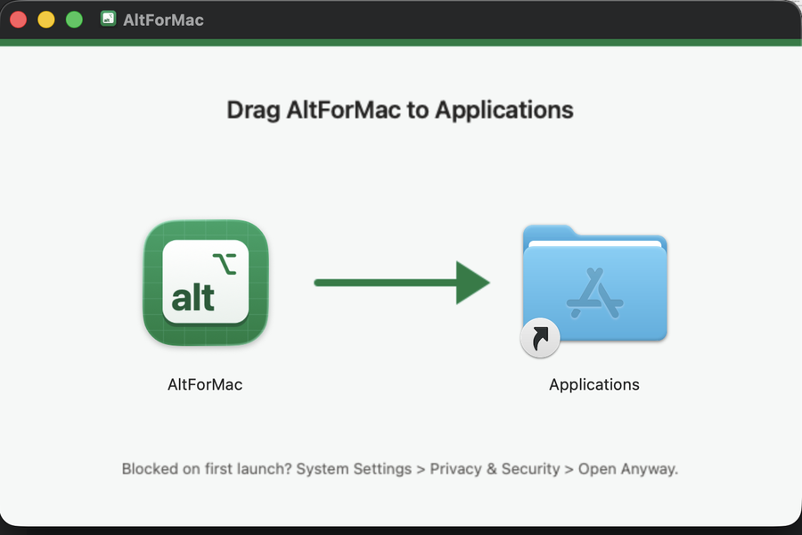
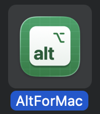
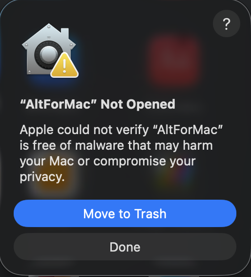
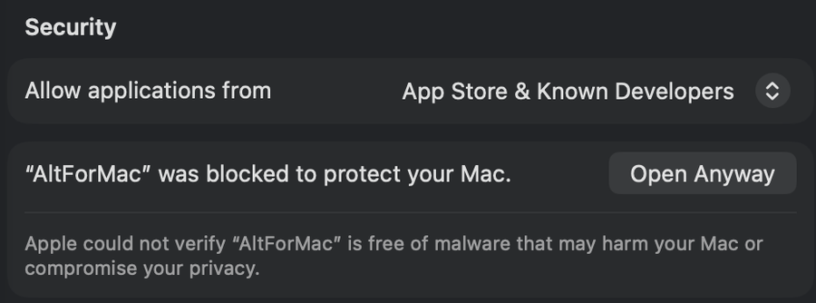
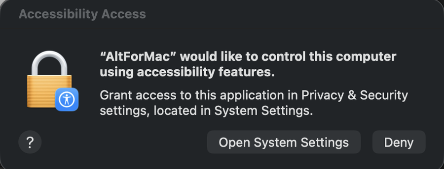
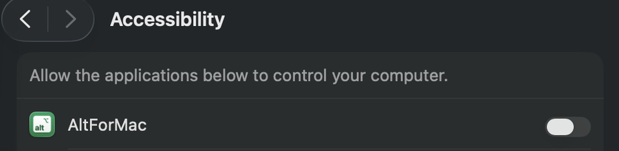
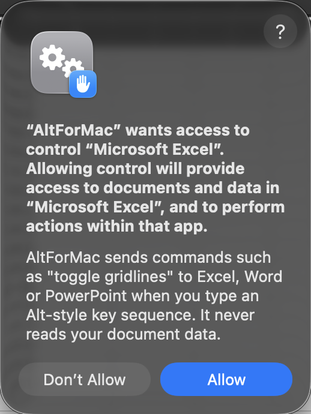

# AltForMac

Windows-style Alt key sequences for Excel, Word and PowerPoint on Mac. Tap Option, type `W V G`,
`H O I` or `N V`, and the command runs, including the final letters inside dropdowns that Office for
Mac's built-in KeyTips leave out.

Free and open source (MIT). Microsoft's code is never modified or shipped.

**Current version: 0.1.3** | [Download](https://github.com/dtung011/altformac/releases/latest/download/AltForMac.dmg) | [Website](https://dtung011.github.io/altformac/) | [Changelog](CHANGELOG.md)

## Install step by step

About two minutes, no Terminal needed. Requires macOS 13 (Ventura) or later on an Apple Silicon Mac
(Intel Macs can [build from source](#other-ways-to-install)). Website with the same guide:
https://dtung011.github.io/altformac/

**1. Download.** Get [AltForMac.dmg](https://github.com/dtung011/altformac/releases/latest/download/AltForMac.dmg) (always the latest version). It goes to your Downloads
folder. Its icon there looks plain; that is normal.

**2. Drag it into Applications.** Double-click `AltForMac.dmg`. In the window that opens, drag the green
AltForMac icon onto the blue **Applications** folder.



**3. Open AltForMac.** Open your **Applications** folder (in Finder, press ⇧⌘A) and double-click
**AltForMac**.



**4. macOS warns you: click Done.** macOS says **"AltForMac" Not Opened**. Click **Done**, not Move to
Trash. This warning appears for apps that are not registered with Apple's paid verification yet. AltForMac
is free and its code is public.



**5. Click Open Anyway.** Open **System Settings** (Apple menu > System Settings), click
**Privacy & Security** and scroll down to **Security**. Next to "AltForMac was blocked", click
**Open Anyway**. Enter your Mac password or use Touch ID, then click **Open**. You only do this once.
(On macOS 13 and 14 you can instead right-click the app and choose **Open**.)



**6. Allow it to use the keyboard.** AltForMac asks for **Accessibility** access. It needs this to see your
keys in Office and press menu items for you. Click **Open System Settings**.



**7. Switch AltForMac on.** In the Accessibility list, turn on the switch next to **AltForMac** and confirm
with your password or Touch ID. The menu-bar icon (top right of the screen) shows `⌥` when it is ready, or
`⌥!` if it still needs permission.



**8. Turn off Office's own KeyTips.** In Excel, open the **Excel** menu > **Preferences** > **Accessibility**
and turn off the Option-key KeyTips. Do the same in Word and PowerPoint if you use them. Otherwise Office and
AltForMac both react to Option.

**9. Try it.** In Excel, tap Option (press and let go), then type `W V G`. The gridlines switch off. The
first time, macOS asks whether AltForMac may control Microsoft Excel: click **Allow**. macOS uses the same
wording for every app; AltForMac only sends commands such as "toggle gridlines" and never reads your
documents. Word and PowerPoint ask once too.



### After an update

Until AltForMac is signed with a Developer ID, macOS treats each new version as a different app, so the old
Accessibility switch no longer applies and the menu-bar icon shows `⌥!`. Select AltForMac in the
Accessibility list, click the minus button, open AltForMac again and switch on the new entry. Or run
`tccutil reset Accessibility dev.altformac.app`, reopen AltForMac and switch it on.

### Other ways to install

**Homebrew** (skips steps 4 and 5):

```sh
brew install --cask dtung011/altformac/altformac
```

Update later with `brew upgrade --cask altformac`.

**Build from source** (Intel Macs too). Needs Xcode or the Command Line Tools (`xcode-select --install`):

```sh
git clone https://github.com/dtung011/altformac.git
cd altformac
scripts/package.sh        # builds dist/AltForMac.app and the DMG
```

To check a download, compare `shasum -a 256 AltForMac-<version>.dmg` with the SHA-256 in the
[release notes](https://github.com/dtung011/altformac/releases/latest).

## Use

With Excel, Word or PowerPoint in front:

| Keys | What happens |
| --- | --- |
| tap Option | start a sequence; a small HUD shows the typed keys and the valid next letters |
| letters / digits | follow the Windows sequence, for example `W V G` toggles gridlines |
| Escape | go up one level (exits at the top) |
| Backspace | remove the last letter |
| click, or 5 s idle | cancel |

Holding Option with another key (Option+arrows, Option+Enter) works as normal. Destructive commands keep
Office's own confirmation dialogs.

Sequences live in [mappings/](mappings/): `excel.yaml` (206), `word.yaml` (107), `powerpoint.yaml` (74).

## Uninstall

Pick the way that matches how you installed it:

1. **From the app (DMG installs, 0.1.3 and later).** Click the `⌥` menu-bar icon and choose
   **Uninstall AltForMac…**. It removes AltForMac's Accessibility and Automation permissions, moves the app
   to the Trash and quits.
2. **Homebrew.** `brew uninstall --cask altformac` quits the app, deletes it and removes its permissions
   (add `--zap` to also remove its support files). Remove the tap with `brew untap dtung011/altformac` if you
   no longer want it.
3. **Dragged to the Trash yourself.** macOS keeps every deleted app's privacy permissions, and a deleted app
   cannot remove them. They do nothing once the app is gone, but to clear them run
   `tccutil reset All dev.altformac.app`, or in System Settings > Privacy & Security open Accessibility and
   Automation, select AltForMac and click the minus button.

Afterwards, **turn Office's own KeyTips back on** if you want them: Preferences > Accessibility in Excel,
Word and PowerPoint.

AltForMac installs no background services and writes nothing outside its own app bundle, so there is
nothing else to clean up. If you added it to Login Items, remove it there too (System Settings > General >
Login Items).

## Privacy

- No networking code at all.
- Never reads cell values, formulas, file paths or document content. Accessibility is used only for
  menu, ribbon and focus elements.
- Keys are inspected only while an Office app is frontmost, held in memory only while a sequence is in
  progress, and never written to disk.
- If an app stops responding for 2 s, all keys pass straight through. It never blocks typing.

## Versioning

AltForMac uses [Semantic Versioning](https://semver.org/): `MAJOR.MINOR.PATCH`.

- **PATCH** (0.1.0 to 0.1.1): bug fixes and corrected or added mappings.
- **MINOR** (0.1.x to 0.2.0): new features or apps. While the version is below 1.0, a minor release may
  change behavior.
- **MAJOR** (1.0.0 and up): breaking changes, such as a changed mappings format.
- Pre-releases use a suffix, for example `0.2.0-beta.1`, and are marked "Pre-release" on GitHub.

The version is stored in the [VERSION](VERSION) file and stamped into the app by `scripts/package.sh`.
Releases are tagged `vX.Y.Z`.

## Changelog and release notes

- [CHANGELOG.md](CHANGELOG.md): every notable change, newest first.
- [docs/release-notes/](docs/release-notes/): user-facing notes per release (also shown on the
  [Releases page](https://github.com/dtung011/altformac/releases), next to each download).

Maintainers: see [docs/RELEASING.md](docs/RELEASING.md) for how to cut a release.

## Develop

```sh
swift build
scripts/test.sh                      # Swift Testing; plain `swift test` needs full Xcode
swift run AltForMac
swift run mapping-check mappings/excel.yaml
swift run ribbon-dump --out docs/dumps/excel-menubar.json --menu-only
```

Design: [docs/architecture.md](docs/architecture.md). Build rules and conventions: [CLAUDE.md](CLAUDE.md).
Dumps used for validation must contain no workbook content; read the privacy rules in CLAUDE.md first.

## License

MIT, see [LICENSE](LICENSE).
